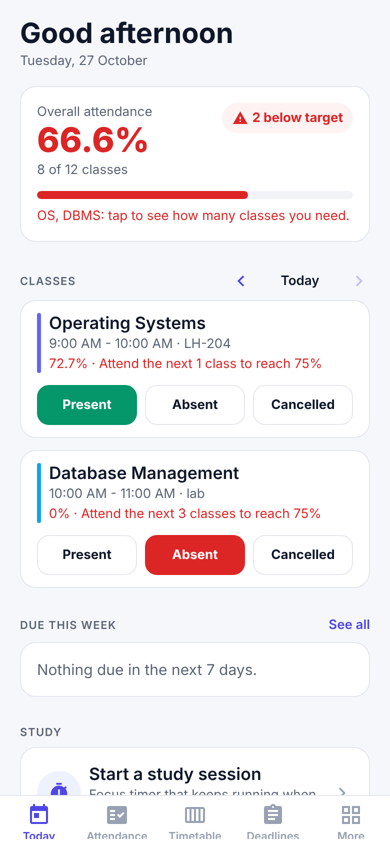
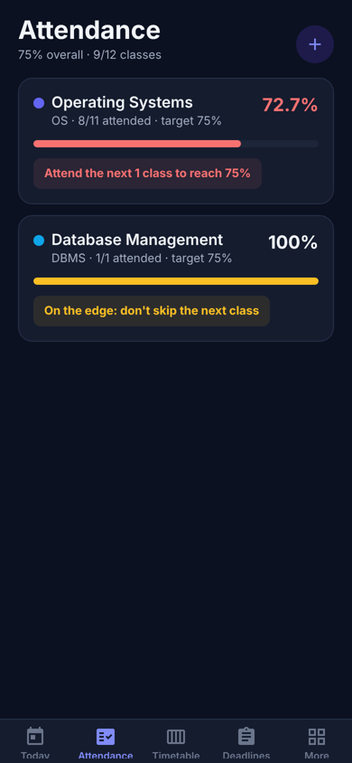
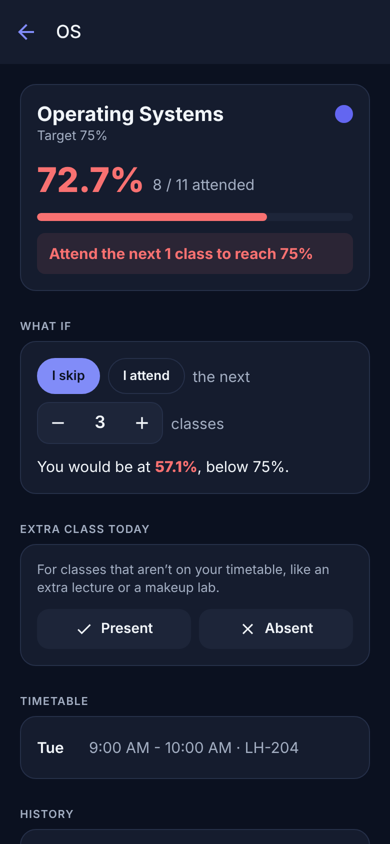
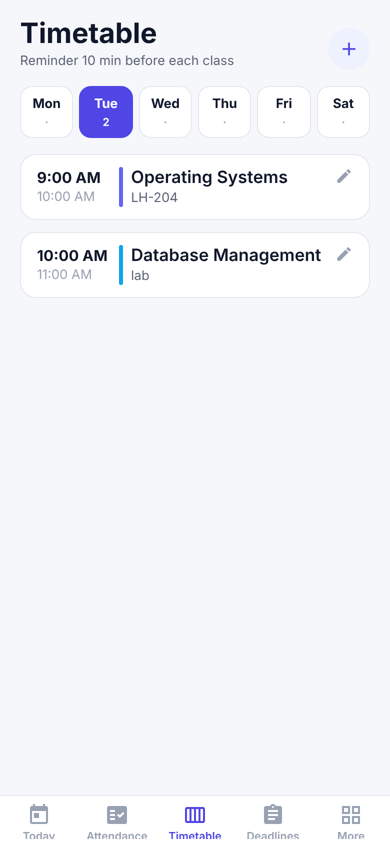

# Bunkmate

**Attendance, timetable and deadlines for college students, in one app.**

Bunkmate answers the question every student asks before skipping a class: *can I afford to?* Mark each class with one tap and it tells you, per subject, exactly how many classes you can still skip, or how many in a row you need to attend to get back above your college's cutoff (75% by default).

Everything stays on your phone. No account, no ads, works offline.

<p>
  
  
  
  
</p>

## Features

**Attendance**
- One tap per class: Present, Absent, OD (on duty / medical / sports leave) or Cancelled. Tap again to undo. Cancelled classes don't count.
- **Holiday** and **All present** buttons mark the whole day in one tap, with undo.
- **"Can I skip tomorrow?"** gives one answer for the whole day, with each subject's percentage after skipping.
- A clear verdict for each subject, such as *"You can skip 3 classes"*, *"On the edge: don't skip the next class"* or *"Attend the next 4 classes to reach 75%"*.
- **What-if planner:** see your percentage if you skip or attend the next *N* classes.
- OD counts as present by default. You can switch it to "not counted" if your college treats it that way.
- **Evening reminder** (5–9 PM) to mark the day's classes, skipped once everything is marked.
- Per-subject target (50-100%), plus a starting count for when you begin mid-semester.
- Mark yesterday's or older classes from the Today screen, add extra classes that aren't on the timetable, and see the full history with delete.
- Percentages are floored, never rounded up, so 74.9% is never shown as 75%.

- **What-if planner:** see your percentage if you skip or attend the next *N* classes.
- Per-subject target (50-100%), plus a starting count for when you begin mid-semester.
- Mark yesterday's or older classes from the Today screen, add extra classes that aren't on the timetable, and see the full history with delete.
- Percentages are floored, never rounded up, so 74.9% is never shown as 75%.

**Timetable**
- Weekly schedule from Monday to Saturday (Sunday optional), with lectures, labs and tutorials, rooms and clash warnings.
- Add the same class to several days at once.
- **Reminders before every class** (5, 10, 15 or 30 minutes, or off).

**Deadlines**
- Assignments, exams, quizzes, lab records and projects, tagged by subject.
- Reminders a day before and an hour before.
- Overdue, upcoming and completed sections. Nothing is ever auto-deleted.

**More**
- **Study timer** that keeps counting when the phone is locked and notifies you when it's done, plus a study log.
- **CGPA calculator:** SGPA per semester and credit-weighted CGPA on the 10-point scale (O, A+, A, B+, B, C, P, F), or typed grade points.
- **Backup:** export everything as text and import it on another phone.
- Light, dark or match-phone theme.

## Run it

You need Node.js 18 or newer and the **Expo Go** app on your phone.

```bash
git clone https://github.com/Abhinav-836/Bunkmate.git
cd Bunkmate
npm install
npx expo start
```

Scan the QR code with Expo Go (Android) or the Camera app (iOS). Press `w` to open it in a browser instead. Reminders only work on a phone.

### Build an APK

```bash
npm install -g eas-cli
eas login
eas build -p android --profile preview
```

## Checks

```bash
npm test           # attendance maths, CGPA and date logic
npm run typecheck  # TypeScript
npm run lint
```

## How the numbers are calculated

With `a` classes attended out of `t` held and a target of `T`%:

- **Classes you can skip:** the largest `k` with `a / (t + k) ≥ T%`, which is `floor((100a − T·t) / T)`.
- **Classes you must attend:** the smallest `n` with `(a + n) / (t + n) ≥ T%`, which is `ceil((T·t − 100a) / (100 − T))`.

Both use whole-number maths, so results are exact at the cutoff. See [`lib/attendance.ts`](lib/attendance.ts) and its tests in [`lib/__tests__`](lib/__tests__).

## Project structure

```
app/
  (tabs)/            Today, Attendance, Timetable, Deadlines, More
  subject/[id].tsx   Subject detail, what-if planner, history
  study.tsx          Study timer
  cgpa.tsx           CGPA calculator
  settings.tsx       Reminders, target, theme, backup
components/          Shared UI, pickers, subject form
context/AppContext   App state, saving, reminder scheduling, theme
lib/                 Attendance / GPA / date logic, storage, notifications
```

Built with Expo SDK 54, React Native, Expo Router, AsyncStorage and expo-notifications (local only).

## License

[MIT](LICENSE) © Abhinav Ashutosh